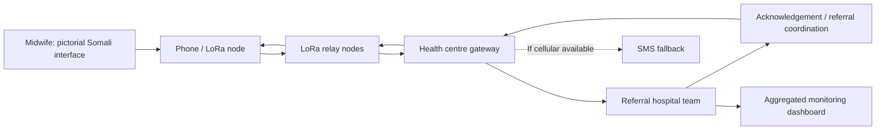

# Proposed system architecture — unvalidated

## Proposed flow

1. Midwife selects a danger sign and confirms the intended recipient.
2. Device sends a minimal alert identifier and required referral metadata over a radio mesh.
3. Relay nodes attempt delivery to a staffed gateway.
4. Facility team acknowledges receipt and coordinates next steps using approved clinical protocols.
5. The originating midwife receives acknowledgement if the return path is available.
6. Only appropriately de-identified, aggregated metrics are considered for public reporting.

## Engineering cautions

- Multi-hop coverage to Kismayo has **not** been demonstrated; relay placement and topology must be measured.
- Store-and-forward, priority handling, delivery acknowledgements and SMS fallback are **proposed adaptations**, not verified capabilities of this project.
- LoRa payload size, airtime, latency, frequency licensing, encryption and resilience must be assessed.
- No assumption should be made that a basic phone directly supports the proposed interface without compatible hardware/software.
